<p align="center">
  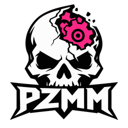
</p>

<h1 align="center">PZMM</h1>

<p align="center">
  A free mod manager, server browser and server host for Project Zomboid. Windows and Linux.<br>
  <a href="#install"><b>Install</b></a> · <a href="../../releases/latest">Download</a> · <a href="https://discord.com/invite/6URUy6mNzu">Discord</a> · <a href="docs/FEATURES.md">Everything it does</a>
</p>

<p align="center">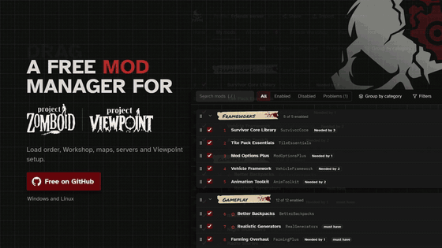</p>

I made PZMM because of [Project Viewpoint](https://steamcommunity.com/sharedfiles/filedetails/?id=3809306528). Getting it running means two Workshop items, a jar and a DLL in the game folder and a launch flag, and the next game update can wipe the flag again. PZMM does all of that from one menu.

Then it kept growing. It's a proper mod manager now, it gets you into modded servers with exactly the right mods, and it runs dedicated servers too.

<a id="install"></a>
<p align="center">
  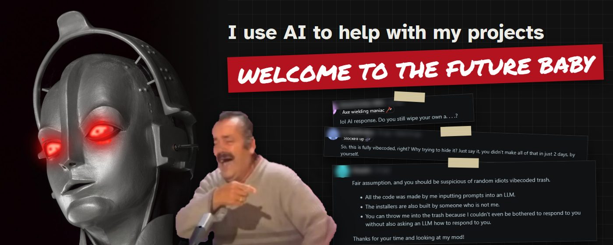
</p>

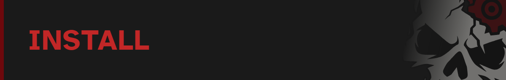

> [!WARNING]
> **Early access.** PZMM is new and still in development, so you may run into bugs. Back up your saves before using it.
>
> **Found a bug?** Report it on [Discord](https://discord.com/invite/6URUy6mNzu) or [open a GitHub issue](https://github.com/SEVNC3/pz-mod-manager/issues/new?template=bug_report.yml). Say what you did, what happened and what you expected, and paste the diagnostics from **Settings > About > Copy diagnostics** (your user name is masked).
>
> **Only download it from [GitHub Releases](https://github.com/SEVNC3/pz-mod-manager/releases).** Copies on other sites may have been tampered with.

### Windows

1. Open the [latest release](../../releases/latest) and download `PZMM_<version>_x64-setup.exe`. That's the only file you need.
2. Run it. Windows will probably put up a blue "Windows protected your PC" box, because the installer isn't code-signed yet (that costs money every year). Click **More info**, then **Run anyway**.
3. Start PZMM from the Start menu.

### Linux

- Any distro: download `PZMM_<version>_amd64.AppImage`, make it executable (`chmod +x PZMM_*.AppImage`) and run it.
- Debian or Ubuntu: download `PZMM_<version>_amd64.deb` and install it with `sudo apt install ./PZMM_*.deb`.
- Workshop downloads go through SteamCMD, which needs 32-bit libraries: `sudo apt install lib32gcc-s1`.

Running a server box with no desktop? `pzmm-linux-x64` and `pzmm-windows-x64.exe` are the [command-line version](#command-line-pzmm): one file, nothing to install.

You can ignore the `.sig` files and `latest.json` on the release page; they're for the updater. `SHA256SUMS.txt` is there if you want to check your download is the real thing.

### First run

PZMM finds the game and your `Zomboid` folder by itself. If it can't, set them under **Settings → Folders**. Your current mod list becomes a profile called **Default**, so nothing changes until you change it. Then hit **Play**.

### Updates

PZMM checks for new versions on its own. When there's one, **Update and restart** shows up above the tabs. Updates are signed, so it won't install anything I didn't build.

### The basics

1. Paste a Workshop link, a GitHub repo or a zip path into the box at the top and click **Install**. The mod is installed and turned on.
2. Tick or untick mods in **My mods**. The library on the left is your own arrangement: drag rows (or **Alt+↑/↓** on a selected one), and **Space** toggles a mod. The **load order** beside it is what the game actually loads: drag it, **Alt+↑/↓** it, or click **Autosort**.
3. **Separator** groups your library; **Group by category** sorts it into sections for you. Double-click a separator to rename it, drag it to move its whole section, **Delete** removes it (its mods stay put).
4. Click **Play** on Home, or **Launch game**.

**Build 41 or 42?** PZMM keeps whatever format your `default.txt` already uses, and a new file gets the Build 42 format. To set it yourself, go to **Settings → Game build**. The previous file is always kept as `default.txt.bak`.

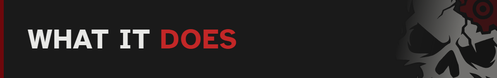

### Pick a server, click Join

PZMM opens on **Home**: your profile or the server you picked, a big **Play** or **Join** button, and whatever needs doing (problems, updates, a server's missing mods) with a button that does it. If your last save uses the same mods, **Continue** gets you back in with one click.

<p align="center">
  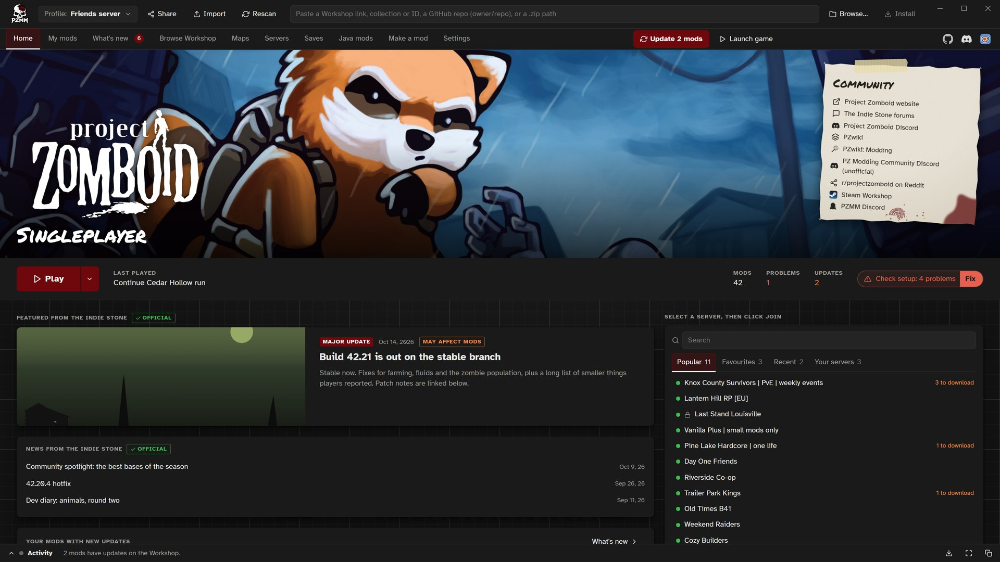
</p>

Joining a modded server normally means subscribing to its mods one by one and praying your load order matches. **Set up and join** downloads exactly the mods the server runs, puts its load order and maps in a profile of its own and starts the game connected. Your own mod lists stay as they were. Before it downloads anything it shows you every mod and its size, and it warns you when a mod was updated on the Workshop after the server last restarted, which is the usual reason for "version is different".

<p align="center">
  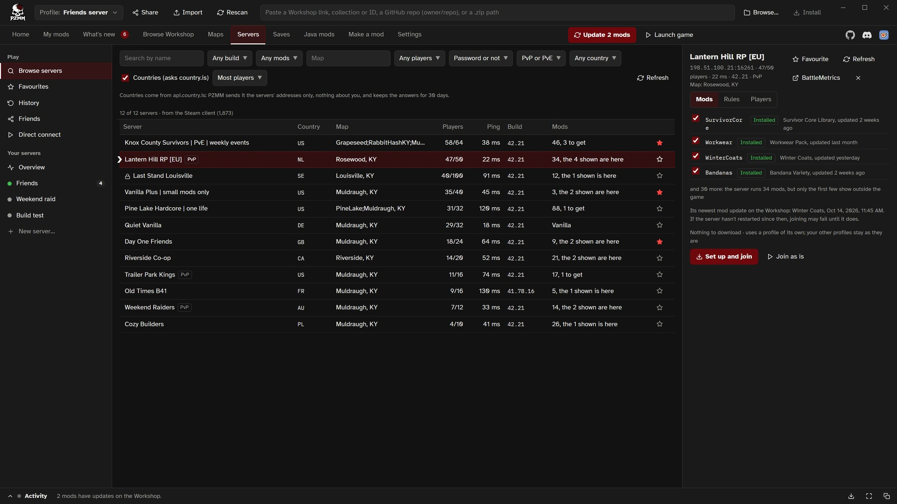
</p>

The server browser filters by build, mods (including "only ones I have"), map, players, password and PvP, and has favourites, history and direct connect. On Windows it gets the Internet list through your running Steam. On Linux it needs a Steam Web API key.

### Build 42 emptied your mod list again

After some updates, Build 42 wipes `default.txt` on its first start and you're back to vanilla. PZMM writes the file that tells the game not to. If the game empties the list anyway, PZMM keeps yours and puts it back the next time you launch from it.

### Library and load order

Your library and the load order are two separate lists, like Mod Organizer 2. Arrange the library however you like with separators, categories, tags and favourites; the load order is what the game reads.

<p align="center">
  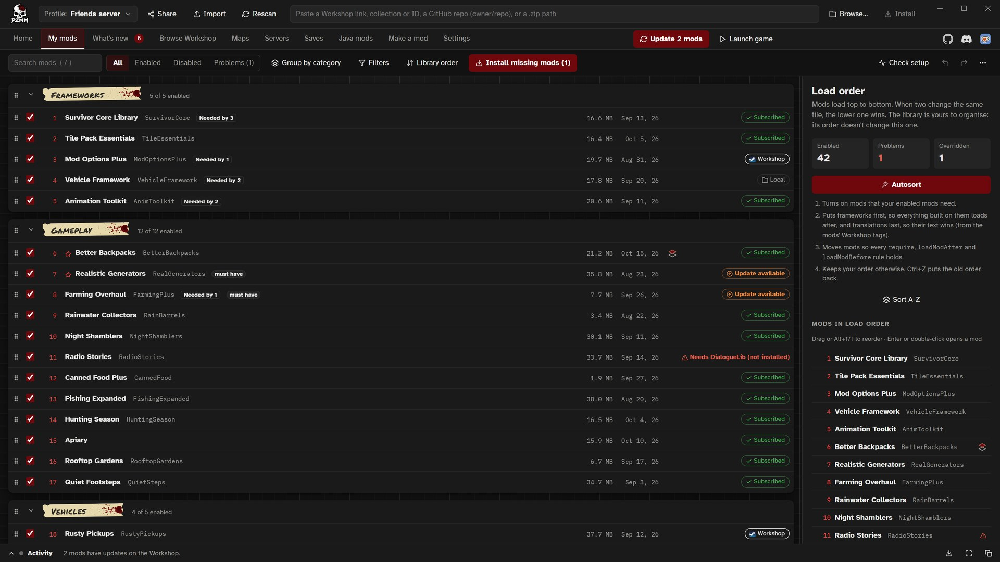
</p>

**Autosort** puts frameworks first and translations last, and satisfies every `require`, `loadModAfter` and `loadModBefore` line the mods ship with. It reads and writes Mod Load Order Sorter's rules too. Don't like what it did? Ctrl+Z.

<p align="center">
  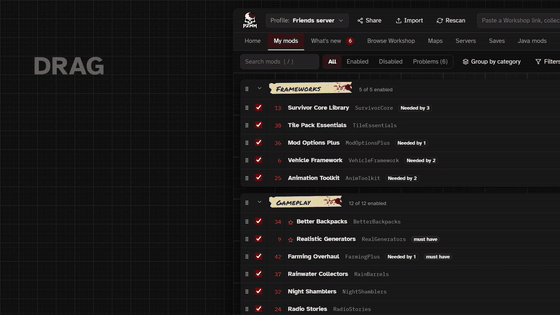
</p>

### Find the broken mod

The game crashes and the log won't say why. **Find the broken mod** turns off half your mods, you test, it halves again until it's found. It starts with the mods the log blames, and puts your list back when you're done.

<p align="center">
  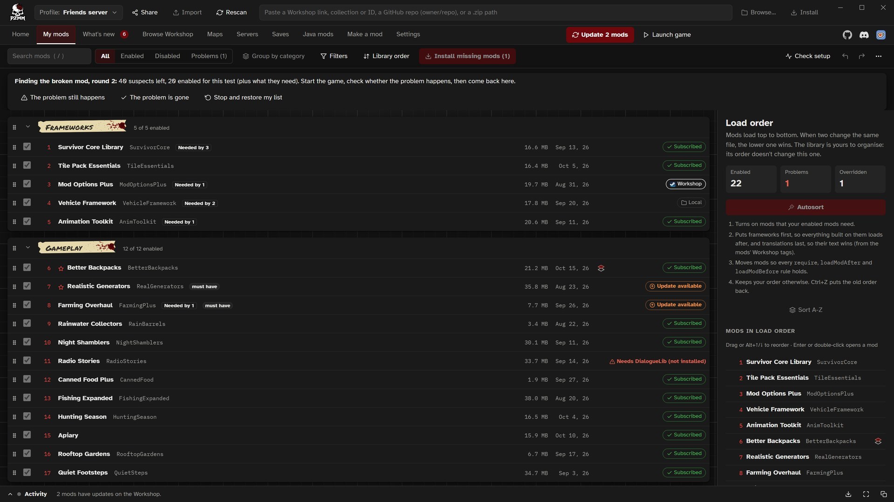
</p>

**Check setup** catches a lot before you get that far: wrong-build mods, missing or late requirements, conflicts, broken Lua, duplicate mod IDs and Workshop items that have vanished.

### The Workshop, without logging in

The whole Workshop inside the app: search, tags, B41 and B42 filters, popular over any period, collections, and an item panel with screenshots, change notes, comments and what needs it. Installs come down anonymously, so there's no subscribing and no Steam login. Required mods come along too.

<p align="center">
  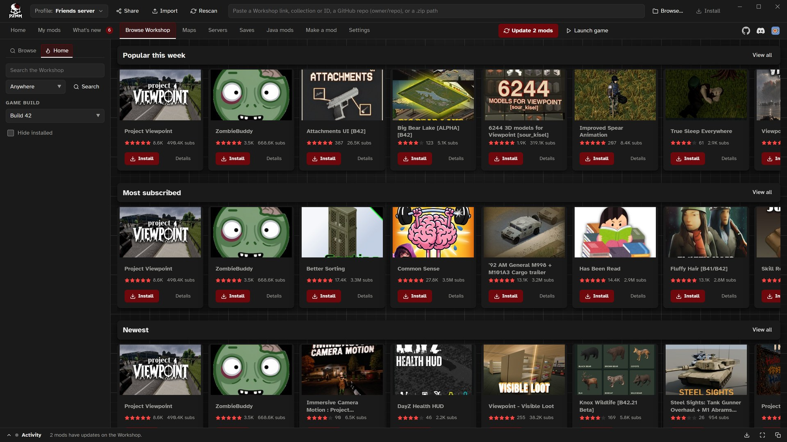
</p>

### Maps

Every Workshop map, installed or not, on one cell grid. You see the clashes before you subscribe to anything, PZMM can pick the biggest set that fits, and it writes the map order for you (or for your server).

<p align="center">
  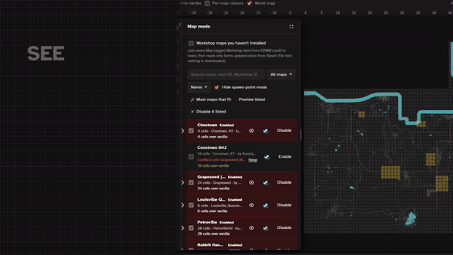
</p>

### Project Viewpoint and ZombieBuddy in one click

**Set up Project Viewpoint…** in the profile menu shows you every change first, then downloads [ZombieBuddy](https://github.com/zed-0xff/ZombieBuddy) and Viewpoint from the Workshop, copies ZombieBuddy's files into the game folder (on any drive), adds the launch flag and makes a Viewpoint profile. Your normal mods stay in their own profile. When a game update or Steam's "Verify integrity of game files" removes the flag, PZMM notices and fixes it in one click. Java mods you turn on in PZMM are approved in ZombieBuddy when you press Play, so the game doesn't ask again (jars with scan warnings, or not from the Workshop, still ask).

<p align="center">
  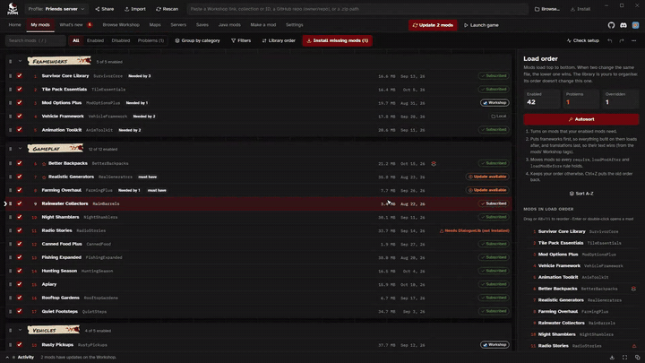
</p>

Viewpoint is made by ellu and norkus, and ZombieBuddy by zed-0xff. They're their projects, not mine; PZMM only installs and manages them. Viewpoint bugs belong on [the Viewpoint Discord](https://discord.gg/g83XvPhEgQ), PZMM bugs on [mine](https://discord.com/invite/6URUy6mNzu).

### Saves

Backups on launch, on exit, while you play and after a crash, plus named slots. There's a sandbox editor for existing saves, recovery resets, and a check before a save's mods change.

### Languages

English, Deutsch, Español, Français, Italiano, 한국어, Polski, Português (Brasil), Русский and 简体中文.

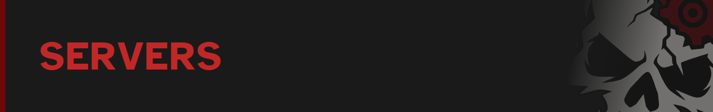

**New server…** walks you through it: name, build (B42, or B41 as `legacy41`), install folder, ports (checked free), passwords, memory and mods from a profile or a collection. SteamCMD installs the server anonymously, and PZMM checks every Workshop ID before writing it, since one bad ID is enough to crash the server.

<p align="center">
  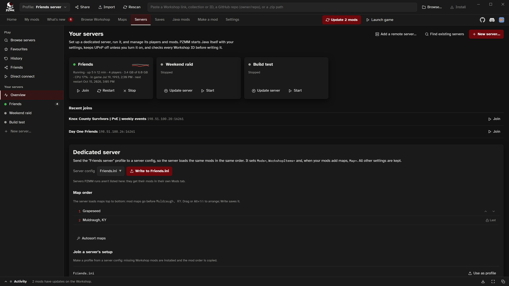
</p>

Once it's up you get a live console with errors, chat and mod lines picked out and pointed at the mod that caused them, a players page (whitelist, bans, notes, where they are on the map), the server's mod list with drag order and Autosort, the `.ini` and sandbox as forms, and backups with one-click restore.

<p align="center">
  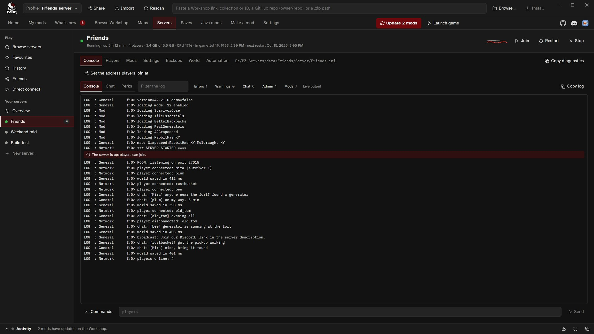
</p>

When a mod updates, PZMM can warn players in game (15, 5 and 1 minutes before), save, update and start the server again, or wait until nobody's on. There are daily restart times, scheduled saves and backups, and crash restarts. Leave PZMM in the tray and all of that keeps running with the window closed.

For Discord there are webhook alerts (started, stopped, crashed with the last log lines, mods updated, joins and leaves), a live status message, optional bot commands for a role you pick, and an optional two-way relay between the game's general chat and a Discord channel.

It also adopts servers you already have in `Zomboid/Server`, finds LinuxGSM and Docker installs, talks to any server over RCON, and edits a rented server's files over FTP. Servers run from PZMM put their exact mod list in their description, so players using PZMM get a perfect match when they join.

**Everything it does:** [docs/FEATURES.md](docs/FEATURES.md). What changed in each version is in the [release notes](docs/release-notes/).

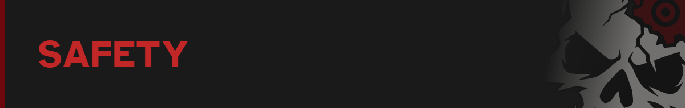

- PZMM only deletes mods it installed. It never touches your Workshop subscriptions or mods you installed by hand.
- Every Java file your enabled mods bring is hashed, checked for a signature and scanned before ZombieBuddy loads it.
- Joining a server, giving a save different mods and setting up ZombieBuddy all list the changes before anything happens. `default.txt` keeps its previous copy as `default.txt.bak`.
- PZMM updates itself with signed updates. Download it only from [GitHub Releases](https://github.com/SEVNC3/pz-mod-manager/releases), and check the file against `SHA256SUMS.txt` if you like.

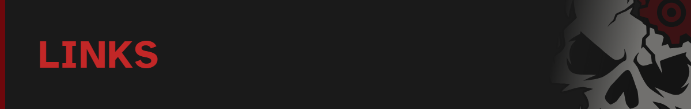

- [Discord](https://discord.com/invite/6URUy6mNzu): help, ideas and bug reports
- [GitHub issues](https://github.com/SEVNC3/pz-mod-manager/issues/new?template=bug_report.yml): bug reports with the diagnostics attached
- [Nexus Mods](https://www.nexusmods.com/profile/SEVNC3) and [GitHub](https://github.com/SEVNC3): whatever else I'm making

PZMM is free and always will be. If it saved you some time and you want to buy me a coffee, there's a [Ko-fi](https://ko-fi.com/sevnc3).

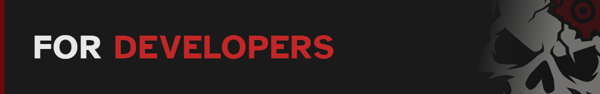

### Command line (`pzmm`)

The command line and the app share the same profiles and data, so a headless server box can run the same setup. Add `--json` to the read commands for machine-readable output.

<details>
<summary>All the commands</summary>

```
pzmm add 2169435993 someone/their-pz-mod ./MyMod.zip
pzmm list
pzmm enable ModId
pzmm disable ModId
pzmm remove ModId
pzmm update
pzmm rollback ModId          # restore the version before the last update
pzmm add --no-enable 2169435993   # install without enabling
pzmm profile list
pzmm profile new Server
pzmm profile use Server
pzmm profile delete Server
pzmm profile rename Server "Friends server"
pzmm profile duplicate Solo "Solo test"   # a copy; stays on the active profile
pzmm snapshot list           # the active profile's lists from before big changes
pzmm snapshot restore 1791000000000   # the id from snapshot list
pzmm build 41                # force the B41 default.txt format
pzmm search snow --sort toprated --build 42 --page 2
pzmm outdated                # Workshop mods with updates waiting
pzmm find tsarslib --install # find the Workshop item that provides a mod id
pzmm server export servertest   # active profile -> Zomboid/Server/servertest.ini
pzmm server import servertest   # server config -> profile (installs missing mods)
pzmm zombiebuddy install     # also: status, uninstall
pzmm mode viewpoint          # or: zomboid; --dry-run lists the changes
pzmm doctor                  # check the profile and server configs (exit code 1 on errors)
pzmm errors                  # Lua errors per mod in the last game session
pzmm profile export friends.json   # share a profile; import with: pzmm profile import friends.json
pzmm server start servertest # start the dedicated server
pzmm server create myserver  # install a dedicated server with SteamCMD and set it up (--build legacy41 for B41)
pzmm server status myserver  # also: stop, console, log, backup, backups
pzmm servers                 # the servers PZMM manages or found
pzmm news                    # your Workshop mods updated since you last played
pzmm check-mod ./MyMod       # check a mod or upload folder before uploading
pzmm watch servertest --every 10 --on-update "restart-server.bat"   # check every 10 minutes; run a script on updates
```

</details>

On Linux, SteamCMD needs 32-bit libraries (`lib32gcc-s1` on Debian/Ubuntu).

| Variable | Default | Purpose |
|---|---|---|
| `PZ_HOME` | `~/Zomboid` | Your Zomboid user folder |
| `PZMM_DATA` | `%LOCALAPPDATA%\pzmm` or `~/.local/share/pzmm` | Profiles, backups, SteamCMD |
| `PZ_GAME_DIR` | found in your Steam libraries | The game's install folder (used for ZombieBuddy) |
| `PZ_SERVER_DIR` | found in your Steam libraries | The Dedicated Server tool's folder |
| `GITHUB_TOKEN` | none | Private repos or a higher GitHub API rate limit |

### Build from source

This needs [Rust](https://rustup.rs) and Node.js 22.18 or newer (the self-checks run TypeScript directly). On Linux it also needs the [Tauri system packages](https://tauri.app/start/prerequisites/).

```
cargo test                                  # core + CLI
cd app && npm ci && npx tauri dev           # desktop app, live reload
cd app && npx tauri build                   # installers in target/release/bundle
```

How the code is organised:

| Path | What it is |
|---|---|
| `crates/core` | Shared logic. Everything specific to Project Zomboid lives in `src/pz/`; downloads (Workshop, GitHub, local) in `src/sources/`. |
| `crates/cli` | The `pzmm` command line |
| `app/` | The desktop app: Tauri 2 with Svelte 5 |

The full plan is in [docs/FOUNDATION.md](docs/FOUNDATION.md). To release, set the new `version` in `Cargo.toml` (and `app/package.json`), then push a matching `v*` tag. CI builds every download, signs the installers with the updater key (GitHub secret `TAURI_SIGNING_PRIVATE_KEY`; a copy is in the maintainer's 1Password), and publishes `latest.json`, which installed copies check for updates. The release page starts with `docs/release-notes/install.md`, then the early-access note, then `docs/release-notes/<tag>.md`.

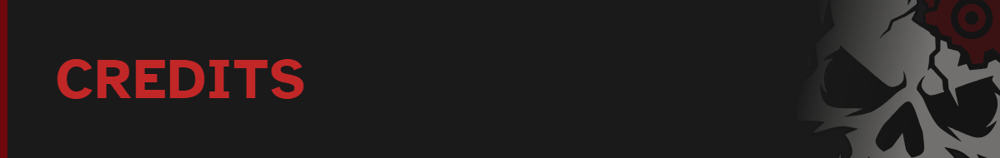

- [Anthropic](https://www.anthropic.com) for [Claude Code](https://claude.com/claude-code)
- Icons: [Feather](https://feathericons.com) (MIT)
- Fonts: [Atkinson Hyperlegible](https://brailleinstitute.org/freefont), [IBM Plex Mono](https://github.com/IBM/plex) and [Permanent Marker](https://fonts.google.com/specimen/Permanent+Marker), all under the SIL Open Font License, via [Fontsource](https://fontsource.org)
- Steam, GitHub, Discord and Ko-fi logos via [Logo.dev](https://logo.dev); they belong to their owners
- ZombieBuddy logo from [ZombieBuddy](https://github.com/zed-0xff/ZombieBuddy) by Andrey "Zed" Zaikin (MIT)
- Server countries (off unless you turn them on): [country.is](https://country.is), which uses MaxMind GeoLite2 data
- Project Zomboid and its art are The Indie Stone's, and Project Viewpoint belongs to its team. PZMM is a fan-made tool and isn't affiliated with either.

### License

MIT
